<picture>
  <source media="(prefers-color-scheme: dark)" srcset="assets/atom-dark.svg" />
  <source media="(prefers-color-scheme: light)" srcset="assets/atom-light.svg" />
  
</picture>

&nbsp;&nbsp;

---

## About

I hold a BSc in ICT (Innovation, Communication and Technologies) from the University of Turin, and I am now enrolled in the MSc in Human-Centered Services for Digital Societies at the same university.

My research interests span the human and the technical side of conversational AI, from user interaction with LLM-based chatbots, mental models and the philosophy of AI to knowledge representation in language models and mechanistic interpretability.

---

## Projects

| Project | Description |
| ------- | ----------- |
| [fake-news-finetuning-vs-prompting](https://github.com/scretifrancesco/fake-news-finetuning-vs-prompting) | Can a small fine-tuned model beat a prompted LLM at spotting fake news? |
| [appunti-ict-unito](https://github.com/scretifrancesco/appunti-ict-unito) | Free, textbook-style LaTeX notes I wrote for the courses of the BSc in ICT at the University of Turin (in Italian) |
| [appunti-shc-unito](https://github.com/scretifrancesco/appunti-shc-unito) | Free LaTeX notes for the courses of the MSc in Human-Centered Services, University of Turin (Italian) |

---

## Tech Stack

<picture>
  <source media="(prefers-color-scheme: dark)" srcset="assets/stack-dark.svg?v=4" />
  <source media="(prefers-color-scheme: light)" srcset="assets/stack-light.svg?v=4" />
  
</picture>
